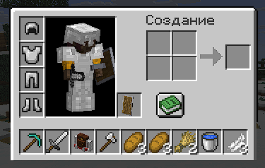
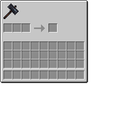
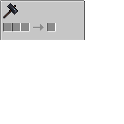

# InventoryControl alpha


_This is a minecraft mod that allows you to shrink your inventory by decreasing the amount of grid rows. Also works on a server._


## Configuration
Here is the default configuration file located in minecraft/inventorycontrol/config.json
```json
{
  "inventoryRows": 0,
  "menuAdjustments": [
    {
      "menuClassPath": "net.minecraft.world.inventory.CraftingMenu",
      "modY": 12,
      "doNotRender": [
        0
      ],
      "renderBackground": true
    },
    {
      "menuClassPath": "net.minecraft.world.inventory.ChestMenu",
      "modY": 18,
      "doNotRender": [
        0
      ],
      "renderBackground": true
    },
    {
      "menuClassPath": "net.minecraft.world.inventory.FurnaceMenu",
      "modY": 6,
      "doNotRender": [
        2
      ],
      "renderBackground": true
    },
    {
      "menuClassPath": "net.minecraft.world.inventory.MerchantMenu",
      "modY": 6,
      "doNotRender": [
        2
      ],
      "renderBackground": false
    }
  ]
}
```
```inventoryRows``` - _(range 0-3)_ how much rows in your inventory you want (0 = only hotbar)

```menuAdjustments``` - a list of MenuAdjustments records
- ```menuClassPath``` - full name of inventory class that you want to change visual parameters for
- ```modY``` - Y axis modificator, it translates player inventory up higher
- ```doNotRender``` - a list of slot indexes that you don't want to render cells for. useful when there's a big result cell in a furnace/somewhere else and you don't want the mod to cover it)
- ```renderBackground``` - should mod render background for inventory

## Important Notes
- **quick item moving** with shift key are **disabled** because of how the mod works. but you can still use numbers 1-9 on your keyboard to move items faster
- since quick item moves are disabled, the mod is **incompatible with MouseTweaks** mod. keep that in mind
- also seems to be **incompatible with Sophisticated backpacks**

## How to use custom inventories with the mod
To use a custom inventory you'll need to replace its texture. you do something like this:

before:



after:



so you just basically cut down the part with inventory slots (you can use photomea if you dont have photoshop)
and then create your own resourcepack to replace original mod texture. then it should work properly!

if you encountered any visual glitches you can always use menu adjustments in the config file and play with parameters.

## TODO
- creative mod looks kinda wierd needs visual fix